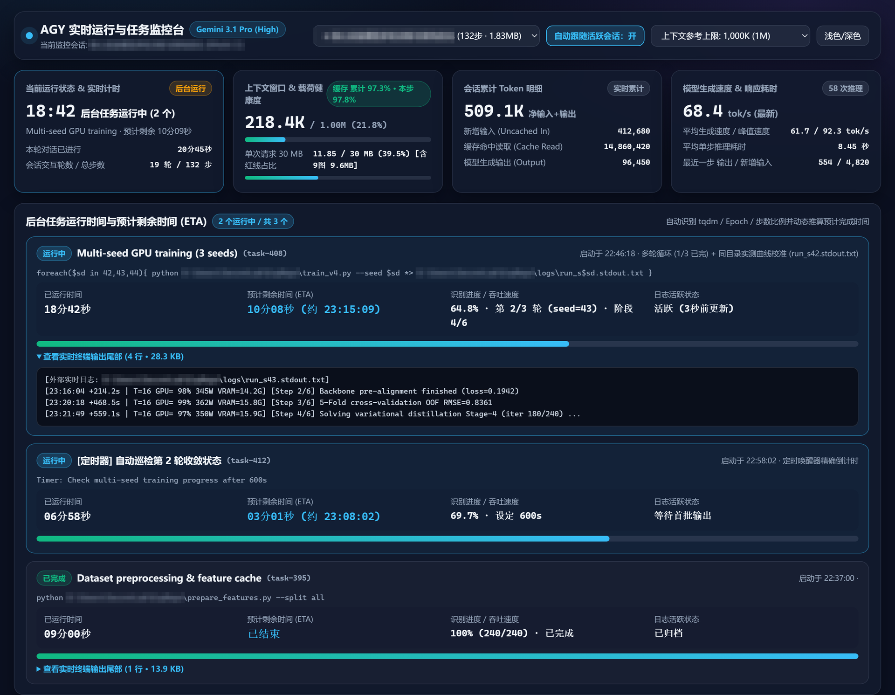
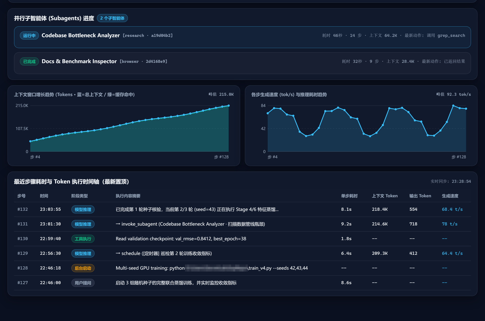
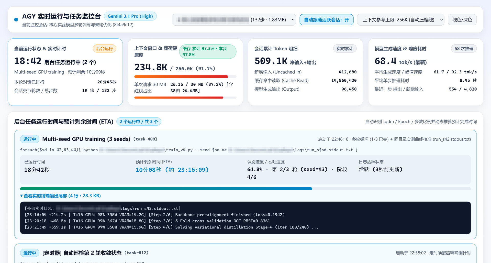
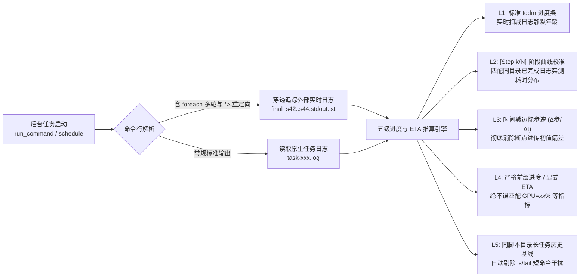

<div align="center">


# AGY-monitor · Antigravity 实时运行与任务监控台

**专为 Google Antigravity (AGY) 打造的零依赖、零上下文开销、全中文实时任务进度、高精度 ETA 与 Token 监控面板**

[](https://github.com/onluuqs/AGY-monitor/releases/latest)
[](#)
[](#%EF%B8%8F-架构设计与隐私安全)
[](#%EF%B8%8F-架构设计与隐私安全)
[](#-3-秒极速安装)
[](LICENSE)

[**✨ 痛点对比**](#-为什么需要-agy-monitor) · [**📸 运行实拍预览**](#-界面运行实拍预览) · [**🚀 3 秒极速安装**](#-3-秒极速安装) · [**🧠 五级 ETA 引擎**](#-五级高精度-eta-推算引擎) · [**🛡️ 架构与安全**](#%EF%B8%8F-架构设计与隐私安全) · [**❓ 常见问题**](#-常见问题-faq)

</div>

---

<div align="center">
  
  <p><sub>▲ 实拍图 1：深色主监控视图 —— 顶部实时动作秒表、四大核心指标卡、多轮种子训练后台任务进度、经验曲线校准 ETA 与实时终端日志尾部</sub></p>
</div>

---

## 🎯 为什么需要 AGY-monitor？

在使用 Google Antigravity 跑深度学习训练、大规模数据处理、多子智能体（Subagents）调研或超长上下文项目时，客户端自带的简易后台列表往往存在**看不到预计完成时间、重定向日志黑盒、服务端重启残留僵尸任务、以及单次请求突破 30 MB 突然报错锁死**等痛点。

| 核心维度 | Antigravity 原生自带面板 | **AGY-monitor 全景监控台 (本项目)** |
| :--- | :--- | :--- |
| **界面与可读性** | 英文简略折叠列表，信息密度低 | **全中文高对比双主题仪表盘**（深色 / 浅色一键切换，0.5 秒平滑读秒） |
| **会话标题一致性** | 日志目录仅显示无意义 UUID 哈希 | 只读同步官方 `conversation_summaries.db`，**100% 还原侧边栏会话标题与活跃绿点** |
| **后台任务预计剩余时间 (ETA)** | ❌ 无任何剩余时间或完成时刻预估 | ✅ **五级高精度 ETA 校准引擎**，实时显示倒计时与预计完成挂钟时刻（如 `约 23:15:09`） |
| **重定向日志与多轮循环** | ❌ `*> xxx.stdout.txt` 时原生日志显示 0 字节 | ✅ **自动穿透外部重定向日志**与 PowerShell `foreach` 多轮种子循环，合成总进度 |
| **僵尸任务与定时器清理** | ❌ 服务重启后旧任务永久卡在 Running | ✅ 自动识别 `server restart` 中断记录与 `schedule` 唤醒联动，**零僵尸残留** |
| **30 MB 请求载荷红线预警** | ❌ 黑盒不可见，超限直接 `HTTP 400` 锁死会话 | ✅ 精确计算 **`/compact` 后活跃文本 + 全量历史内联图片 Base64**，橙/红双级提前预警 |
| **Token 账单与推理速度** | ❌ 无累计明细，无生成速率曲线 | ✅ 实时统计未缓存输入 / KV 缓存读取 / 输出 Token 及 **`tok/s` 推理速度双联趋势图** |
| **启动方式与上下文成本** | 仅限客户端内固定窄栏查看 | **随 AGY 启动与重连自动同步拉起**，空工具 MCP 守护实现 **`0 Token` 零上下文污染** |

---

## 📸 界面运行实拍预览

### 1. 子智能体协同追踪 · 双联 SVG 实时趋势图 · 倒序步骤时间轴

实时追踪并行子智能体（`browser` / `research` 等）的真实活跃状态与**扣除待命间隙后的净执行耗时**；下方双联面积图同步呈现 **上下文窗口与 KV 缓存演化** 以及 **每步推理生成速度 (`tok/s`)**，底部提供最新置顶的步骤级耗时明细表：

<div align="center">
  
  <p><sub>▲ 实拍图 2：并行子智能体净耗时监控 + 上下文/KV 缓存双层面积图 + 生成速率 (tok/s) 曲线 + 最新置顶步骤时间轴</sub></p>
</div>

### 2. 一键切换浅色主题 & `30 MB` 载荷红线高水位预警

由于云端网关对单次请求体设有 **`30.0 MB` 硬性上限**，且 `/compact` 上下文压缩**不会自动清除已内联的历史图片**，当会话内累计粘贴或检视过多高分辨率图片时极易触发 `HTTP 400 FAILED_PRECONDITION` 锁死。`AGY-monitor` 会自动扫描会话关联的全部媒体体积并折算 Base64 开销，超过 `70%` 变橙预警、超过 `85%` 变红告警：

<div align="center">
  
  <p><sub>▲ 实拍图 3：浅色主题（Light Mode）及多张高分大图内联触发的 30 MB 请求载荷高水位预警效果</sub></p>
</div>

---

## 🚀 3 秒极速安装

> **环境要求**：本机装有任意 **Python 3.9+**（系统 Python、官方 `py` 启动器、Anaconda 或 Miniconda 均可，脚本会自动寻路并自动跳过 Windows 应用商店假 `python.exe` 占位符，**无需 `pip install` 任何第三方包**）。

### 方式一：下载 Release 压缩包双击一键安装（最推荐 · 小白零配置）

1. 前往 [**Releases 页面**](https://github.com/onluuqs/AGY-monitor/releases/latest) 下载最新的 **`AGY-monitor-v2.2.0.zip`** 并完整解压；
2. 根据系统执行一键安装脚本：
   - **Windows**：直接双击运行 **`一键安装到AGY(Windows).bat`**；
   - **macOS / Linux**：在解压目录打开终端执行：
     ```bash
     bash install_mac_linux.sh
     ```
3. 脚本会自动识别本机 Python 解释器，将插件部署到全局目录 `~/.gemini/config/plugins/ag-monitor` 并立即弹出监控面板 **http://127.0.0.1:8765**（建议加入浏览器书签）！
4. 此后**每次启动或重启 Antigravity 客户端，监控后台都会自动同步拉起**，无需再手动运行脚本。

### 方式二：Git 一行命令安装（全局永久生效）

**Windows (PowerShell)：**
```powershell
git clone https://github.com/onluuqs/AGY-monitor.git "$env:USERPROFILE\.gemini\config\plugins\ag-monitor"
```

**macOS / Linux：**
```bash
git clone https://github.com/onluuqs/AGY-monitor.git ~/.gemini/config/plugins/ag-monitor
```
> 克隆完成后，下次对话或重启 Antigravity 即自动生效（Windows 默认通过内置 `run_mcp.cmd` 自动寻路 Python；macOS / Linux 用户运行一次 `bash ~/.gemini/config/plugins/ag-monitor/install_mac_linux.sh` 即可写入本机 `python3` 路径）。

### 方式三：仅在单个项目工作区启用

若只想在特定项目中启用，将其克隆到工作区下的 `.agents/plugins/` 目录即可：
```bash
git clone https://github.com/onluuqs/AGY-monitor.git <你的项目根目录>/.agents/plugins/ag-monitor
```

### 方式四：不打开 Antigravity 独立查看历史会话

随时双击插件目录下的 **`start_monitor.bat`**（或终端执行 `python server.py --host 127.0.0.1 --port 8765`），即可独立拉起面板复盘所有历史会话的 Token 消耗与任务耗时。

---

## 🧠 五级高精度 ETA 推算引擎

普通监控脚本用简单的正则匹配 `%` 或按平均耗时线性外推，遇到训练日志打印 `GPU= 29%`、`valid=99.7%`、断点续传 `(200/250)` 或前快后慢的 `[Step k/6]` 多阶段脚本时就会严重失真。`AGY-monitor` 设计了严密的五级交叉验证管线：



---

## 🛡️ 架构设计与隐私安全

1. **`0 Token` 零上下文污染的自启动机制**  
   利用 Antigravity 原生插件系统的 `mcp_config.json` 托管后台进程生命周期（客户端启动即拉起、Language Server 重启自动恢复、多窗口开启时自动检测 `/api/ping` 进入静默热备防端口冲突）。MCP `tools/list` 严格返回空数组 `[]`，**不注册任何工具、不往模型 System Prompt 注入哪怕 1 个字符**。
2. **100% 纯本地只读，绝对数据安全**  
   - 仅监听本机回环地址 `127.0.0.1:8765`，局域网与公网均无法访问；
   - 对 `conversation_summaries.db` 采用 SQLite URI 只读模式（`?mode=ro`）读取，对 `transcript.jsonl` 与外部训练日志均为纯只读扫描，**绝不修改任何业务代码、实验数据或客户端配置**；
   - 前端无任何外部 CDN、字体或统计脚本依赖，离线断网环境同样毫秒级流畅渲染。
3. **桌面流畅度优先（低优先级守护）**  
   进程启动后自动调用系统 API 将自身设为 `BELOW_NORMAL_PRIORITY_CLASS` 低优先级，并对未变化的会话文件启用 `(mtime_ns, size)` 内存增量缓存，CPU 占用接近 `0%`，绝不与本地 GPU/CPU 重负载计算争抢资源。

---

## 📂 仓库目录结构

```text
AGY-monitor/
├── plugin.json                  # Antigravity 原生插件清单
├── mcp_config.json              # 零 Token 随端自启动守护配置
├── server.py                    # 零依赖 Python 标准库监控后端 (v2.2.0)
├── index.html                   # 全中文双主题实时可视化单页前端 (内嵌原生 SVG 引擎)
├── run_mcp.cmd                  # Windows 免配置 Python/Conda 自动寻路包装器
├── start_monitor.bat            # 独立双击启动脚本（无需打开 AGY 也可随时浏览）
├── 一键安装到AGY(Windows).bat    # Windows 三秒全局安装向导
├── install_mac_linux.sh         # macOS / Linux 一键全局安装脚本
├── logo.svg                     # 插件矢量图标
├── assets/                      # README 高清运行实拍预览图
└── LICENSE                      # MIT 开源许可证
```

---

## ❓ 常见问题 (FAQ)

<details>
<summary><b>Q1：安装后在哪里开关或管理这个插件？</b></summary>
<br/>
打开 Antigravity 客户端左侧栏的 <b>Customizations → Plugins</b>，即可看到带波形图标的 <b>「AGY 实时运行监控台」</b>，点击开关即可实时启用或停用，无需重启软件。
</details>

<details>
<summary><b>Q2：如果 8765 端口被本机其他程序占用了怎么办？</b></summary>
<br/>
只需编辑插件目录下的 <code>mcp_config.json</code>（及 <code>start_monitor.bat</code>），将 <code>--port 8765</code> 改为任意空闲端口（例如 <code>8788</code>），随后访问 <code>http://127.0.0.1:8788</code> 即可。
</details>

<details>
<summary><b>Q3：如何彻底卸载？</b></summary>
<br/>
直接删除 <code>~/.gemini/config/plugins/ag-monitor</code>（Windows 为 <code>C:\Users\&lt;用户名&gt;\.gemini\config\plugins\ag-monitor</code>）文件夹即可，无任何系统注册表或后台服务残留。
</details>

---

## 📄 开源协议

本项目基于 [MIT License](LICENSE) 开源，欢迎自由使用、Fork 与分享给身边的 Antigravity 伙伴！如果觉得好用，欢迎点亮右上角 ⭐ **Star** 支持一下！
